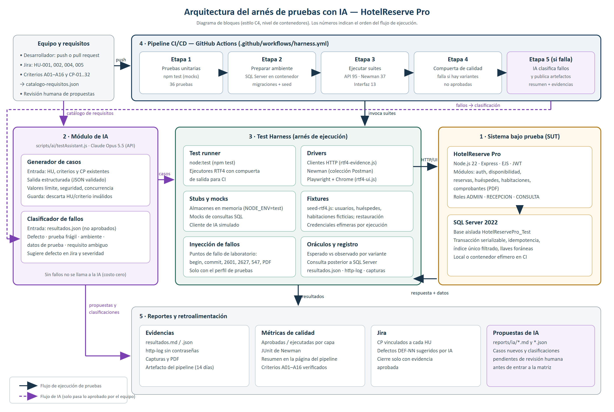

# Arnés de pruebas con IA — HotelReserve Pro (Trabajo 9)



## Componentes

| Componente | Herramienta | Archivo | Función |
|---|---|---|---|
| Sistema bajo prueba | Node.js 22, Express, EJS, SQL Server 2022 | `main.js`, `src/` | API e interfaz de reservas, disponibilidad y comprobantes |
| Test runner | `node:test` | `npm test` | Ejecuta pruebas unitarias y de rutas con dobles de prueba |
| Drivers | Clientes HTTP, Newman, Playwright | `scripts/rtf4-evidence.js`, `docs/rtf4/postman/`, `scripts/rtf4-ui.js` | Invocan el SUT como lo haría un usuario o un cliente de la API |
| Stubs y mocks | Almacenes en memoria, mocks de SQL, cliente de IA simulado | `NODE_ENV=test`, `test/sqlserver-models.test.js`, `test/ai-test-assistant.test.js` | Aíslan la base de datos y la API externa |
| Fixtures | Seed y base aislada | `scripts/seed-rtf4.js`, `HotelReservePro_Test` | Datos ficticios conocidos y restaurables |
| Inyección de fallos | Puntos de fallo de laboratorio | `src/database.js` (`supportedFailpoints`) | Provocan fallos de transacción, 2601, 2627, 547 y PDF solo en el perfil de pruebas |
| Módulo de IA | Claude Opus 5.5 (SDK `@anthropic-ai/sdk`) | `scripts/ai/testAssistant.js` | Propone casos de borde y clasifica fallos; todo queda pendiente de revisión humana |
| Pipeline CI/CD | GitHub Actions | `.github/workflows/harness.yml` | Ejecuta todo en cada push y publica evidencias |
| Reportes | Markdown, JSON, JUnit, Jira | `entregables/`, `reports/` | Resultados por variante, métricas y defectos |

## Uso del módulo de IA

Requiere `ANTHROPIC_API_KEY` (o `ant auth login`). Cada solicitud consume tokens de la API.

```powershell
npm run ia:generar -- --hu HU-001 --maximo 8
npm run ia:clasificar -- --resultados entregables/RTF4/evidencias/api/<ejecucion>/resultados.json
```

- **Generar** envía la HU, sus criterios y los casos existentes, y recibe casos nuevos en JSON
  validado contra un esquema. El arnés descarta los que citan una HU o un criterio inexistente.
- **Clasificar** envía solo las variantes no aprobadas. Si no hay fallos, no llama a la API.
- Las salidas quedan en `reports/ia/` (excluida de Git) y **no se agregan solas a la matriz**:
  un integrante las revisa y aprueba.

## Pipeline

`unitarias` → `integracion` (SQL Server en contenedor, migraciones, seed, API, Newman e interfaz).
Las contraseñas se generan al azar en cada ejecución y se enmascaran en los registros. Si una
etapa falla y el repositorio tiene el secreto `ANTHROPIC_API_KEY`, la IA clasifica los fallos.
Las evidencias se publican como artefacto durante 14 días.
