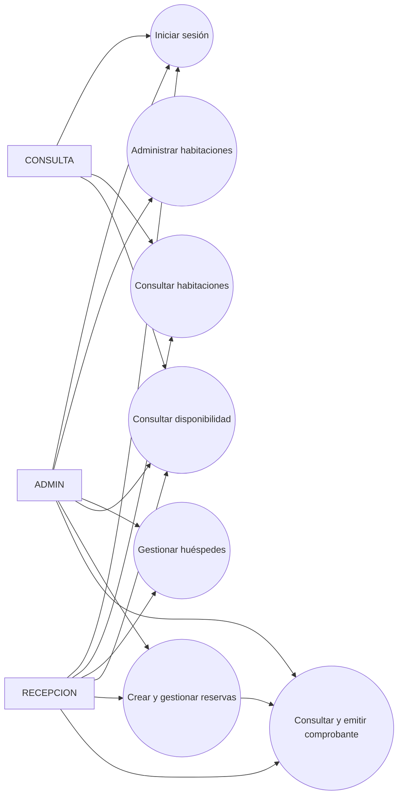
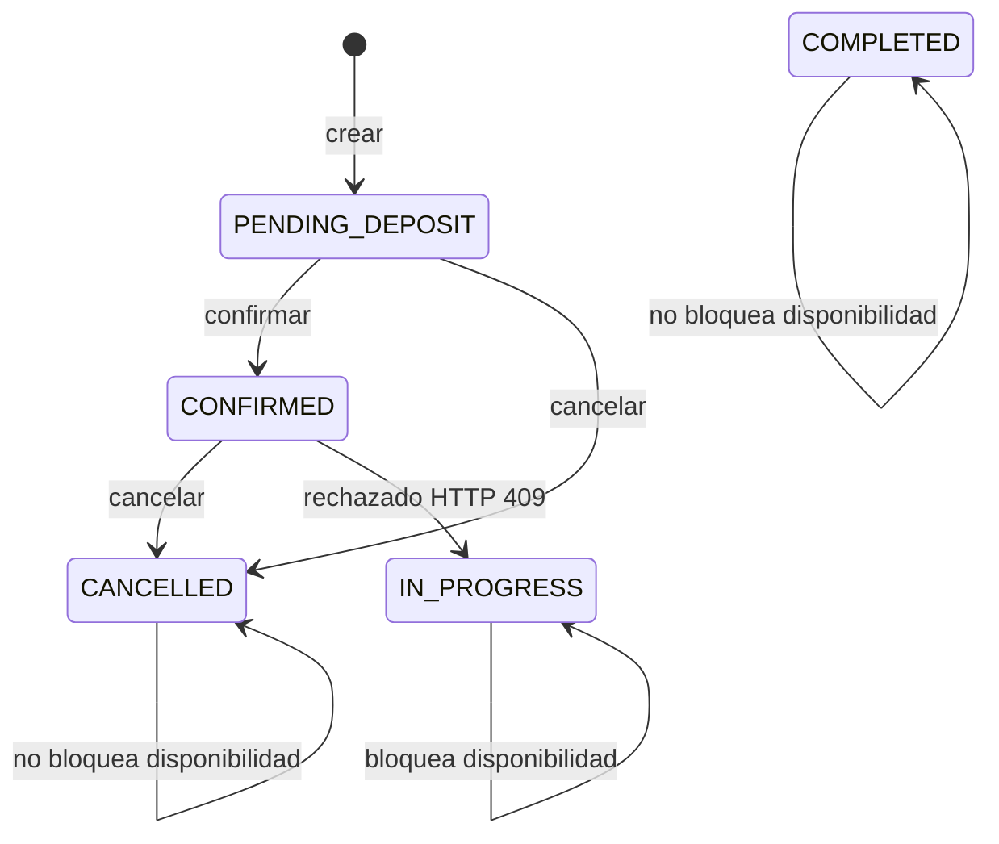

# Modelos RTF4

## Matriz de roles

| Recurso / operación | ADMIN | RECEPCION / RECEPTIONIST | CONSULTA |
|---|---:|---:|---:|
| Panel general | Sí | Sí | No |
| Habitaciones: consultar | Sí | Sí | Sí |
| Habitaciones: crear/editar/eliminar | Sí | No | No |
| Huéspedes: consultar/CRUD | Sí | Sí | No |
| Disponibilidad | Sí | Sí | Sí |
| Reservas: consultar/crear/estado/cancelar | Sí | Sí | No |
| Comprobantes: ver/PDF/consumos/anticipos | Sí | Sí | No |
| Administración de usuarios | No existe en esta versión | No | No |

La matriz se verifica en middleware de servidor y la interfaz oculta enlaces/acciones no autorizados. Ocultar un botón no reemplaza el control de API. Usuarios existentes con rol `RECEPTIONIST` conservan acceso y se muestran como RECEPCION.

## Diagrama de casos de uso



## Diagrama de estados



Solo se implementan transiciones desde PENDING_DEPOSIT y CONFIRMED indicadas. Los estados IN_PROGRESS y COMPLETED son reconocidos por el esquema y la búsqueda, pero no tienen transición de entrada en la API. El diagrama no representa check-in/check-out como funciones disponibles.

## Decisiones económicas

```text
noches = checkOut - checkIn en días calendario
alojamiento = noches * rate_per_night de la reserva
total = alojamiento + SUM(ReservationCharges.amount)
saldo = total - SUM(ReservationPayments.amount)
```

Los valores son COP enteros y se usan tipos SQL `DECIMAL(12,0)`. El comprobante estable `CMP-{reservationId}` es informativo, no factura fiscal. La consulta del PDF no agrega filas a cargos/anticipos.

## Esquema aditivo

- `Reservations.rate_per_night`: snapshot de tarifa capturada al crear la reserva.
- `ReservationRequests`: clave y huella de entrada únicas, ligadas a una reserva; mismo key/entrada recupera el registro, key con otra entrada devuelve 409.
- `ReservationCharges`: consumos persistidos por reserva.
- `ReservationPayments`: anticipos persistidos por reserva.
- `Users.role`: añade valores RECEPCION y CONSULTA, preservando ADMIN y RECEPTIONIST.

La primera inicialización del snapshot para reservas antiguas usa la tarifa actual de habitación porque no había histórico. Esto no puede reconstruir el precio real cobrado en el pasado.
